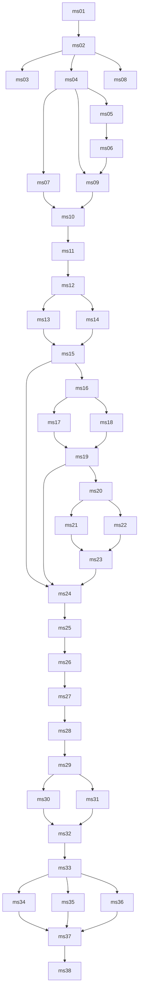

# PART 7 — Quest item catalog

17 quest items, all new **[NEW-ITEM]**, as you allowed. Everything else the quests ask for is an item the game already has.

**What a quest item is.** An ordinary item (`kind: 'Special'`, stack 64) with four rules:

1. It **only drops while its quest is active** (and not when the player already holds enough). Normal loot is unchanged: the quest item comes on top of it.
2. It cannot be sold to a merchant, put on the auction house or traded, and it is not lost on death (it stays in the bags).
3. It is handed in (removed) when the quest is turned in. The three Embers are the one exception: Maren keeps them at ms24 and a `give` hands them back at ms33.
4. Abandoning the quest removes nothing; the item simply stays until the quest is taken again or the item is dropped. (Plain and forgiving.)

| ID | Item id | Name | Quest | Dropped by | Chance | Pity |
|---|---|---|---|---|---|---|
| QI01 | `rift_singed_rag` | Rift-Singed Rag | ms04 | zombie | 35% | |
| QI02 | `torn_satchel_scrap` | Torn Satchel Scrap | ms07 | zombie | 25% | |
| QI03 | `drowned_reed_charm` | Drowned Reed-Charm | ms13 | drowned | 30% | |
| QI04 | `reed_ember` | Reed Ember | ms15 (also ms24, ms33, ms38) | zombie, skeleton, spider, creeper, slime killed in the Lush Cave | 12% | after 15 kills |
| QI05 | `sun_scorched_tally` | Sun-Scorched Tally Stick | ms17 | husk | 35% | |
| QI06 | `caravan_tally_tag` | Caravan Tally Tag | ms18 | llama, trader llama | 30% (plus the normal leather) | |
| QI07 | `sand_ember` | Sand Ember | ms19 (also ms24, ms33, ms38) | hostiles killed in the Dripstone Cave | 12% | after 15 kills |
| QI08 | `frozen_ward_bell` | Frozen Ward-Bell | ms21 | stray | 30% | |
| QI09 | `frost_ember` | Frost Ember | ms23 (also ms24, ms33, ms38) | hostiles killed in the Deep Dark | 12% | after 15 kills |
| QI10 | `warden_ledger_page` | Warden Ledger Page | ms27 | skeleton | 30% | |
| QI11 | `ashen_medal` | Ashen Medal | ms30 | ashen knight | 30% | |
| QI12 | `throne_ember` | Throne Ember | ms37 (also ms38) | The Hollow King | 100% | |
| QI13 | `scorched_fuse` | Scorched Fuse | dw_varro_3 | creeper | 30% | |
| QI14 | `sealed_coffer` | Sealed Coffer | gk_aldren_1 | skeleton, zombie | 25% | after 20 kills |
| QI15 | `spore_jar` | Spore Jar | dw_hale_1 | spore puff | 40% | |
| QI16 | `bear_claw` | Bear Claw | fg_sigrun_3 | polar bear | 100% | |
| QI17 | `gilded_scale` | Gilded Scale | eg_tide_2 | gilt drake | 40% | |

**Per player, in a party.** Every player who earned credit for the kill and has the quest active rolls on their own. The item goes straight into that player's bags (or at their feet if full). Nobody competes for a quest item.

**Why the Embers are not a boss drop (except the last).** Quest items from cave zones need `zone` on the drop rule, so the drop is only possible where the story says (the cave). That is one optional field on the drop table, not a new system.

**Drop table shape (the data to add, `[T1]`):**

```ts
export interface QuestDrop {
  quest: string;          // the quest that must be active
  item: number;           // the quest item id
  mobs: readonly MobKind[];
  zone?: string;          // only here (e.g. 'lush_cave')
  chance: number;         // 0..1, per kill, per eligible player
  pity?: number;          // guaranteed after this many kills without one
}
```

---

# PART 8 — Dependency graph

Main line (solid), and where the sides hang from. `M` is a main quest, `S:` a side line. An arrow means "requires".



**Side lines hang from the main line** (a side line never blocks a main quest):

| Line | Starts after | Chain |
|---|---|---|
| Wick (farming) | ms01 | dw_wick_1 → 2 → 3 → 4 |
| Nell (cooking) | ms03 | dw_nell_1 → 2 → 3 |
| Tobin, Hilda, Garrick, Fenna, Lysa, Brannoc, Varro, Isolde, Maren, Mirel, Ilse, Hale, Corvin, Bram | ms01 to ms10 (see each) | short chains of 1 to 4 |
| Class lines | ms01 | cl_x1 → 2 → 3 → 4 → 5 (3 lines, one per class) |
| Wayfarer's Ledger | ms04, ms16, ms32 | ex_1 → 2 → 3, ex_5, ex_4, ex_6 |
| Reedhollow | ms12, ms14 | rh_tamsin_1 → ..., rh_dunstan_1 → 2 |
| Sandmere | ms16 | sm_idris_1 → 2, sm_oska_1 → 2, 3 |
| Frostgate | ms20 | fg_halvard_1 → 2, fg_sigrun_1 → 2 → 3 |
| Highmarket | ms25, ms28 | hm_thessaly_1 → 2, hm_vael_1 → 2 → 3, hm_trade_1 |
| Greykeep | ms29 | gk_aldren_1, gk_aldren_2 → 3 → 4 |
| Endgame | ms28, ms33, ms38 | wings (4), companions (2), tide (3), rift (1), hollow (1) |

No cycles. Every side requirement is a main quest or an earlier side quest in the same line. This was checked by a script over both quest files: 133 quests, every `Requires` id exists, no cycle.

---

# PART 9 — Data examples

The real `QuestDef` shape, with the two additions: `class` (the class gate, `[T2]`) and the drop table (`[T1]`).

**ms04 · Something Wearing a Face** (a quest item that only drops while active):

```ts
{
  id: 'ms04_something_wearing_a_face',
  name: 'Something Wearing a Face',
  chapter: 1,
  giver: 'varro',
  turnIn: 'varro',
  requires: ['ms02_a_pick_for_a_pilgrim'],
  summary: 'Bring Captain Varro a scrap of what the zombies wear.',
  offer: 'They gather at dusk, at the same place in Whisperwood, as if somebody had called them. Bring me a scrap of what they wear.',
  progress: 'Zombies, at dusk, in Whisperwood. Six of them, and three rags.',
  complete: 'The mark is stitched into the rag. The same mark as on your arm. I did not want to say it first.',
  objectives: [
    { kind: 'kill', mobs: ['zombie'], count: 6, label: 'Kill zombies' },
    { kind: 'collect', items: [I.RIFT_SINGED_RAG], count: 3, label: 'Rift-Singed Rags' },
  ],
  reward: { xp: 12, coins: 24, items: [{ id: ARMOR.leather.chestplate, count: 1 }] },
}
// and in the drop table:
{ quest: 'ms04_something_wearing_a_face', item: I.RIFT_SINGED_RAG, mobs: ['zombie'], chance: 0.35 }
```

**ms15 · The Reed Ember** (a drop only inside a named cave, with a pity counter):

```ts
{
  id: 'ms15_the_reed_ember', name: 'The Reed Ember', chapter: 2, giver: 'tamsin', turnIn: 'tamsin',
  requires: ['ms13_charms_of_the_drowned', 'ms14_what_the_marsh_gives'],
  summary: 'Find the Reed Ember in the Lush Cave.',
  offer: 'We hid it in the lush cave. Our grandmothers called it the bottled sunrise and told us never to look. We looked.',
  progress: 'The Lush Cave. Whatever you kill there may be carrying it.',
  complete: 'It is warm. Take it to Maren. It was never ours to keep.',
  objectives: [
    { kind: 'enter', zone: 'lush_cave', count: 1, label: 'Enter the Lush Cave' },
    { kind: 'collect', items: [I.REED_EMBER], count: 1, label: 'The Reed Ember' },
  ],
  reward: { xp: 103, coins: 309, items: [{ id: ARMOR.iron.chestplate, count: 1 }], classItems: true },
}
{ quest: 'ms15_the_reed_ember', item: I.REED_EMBER, mobs: ['zombie','skeleton','spider','creeper','slime'], zone: 'lush_cave', chance: 0.12, pity: 15 }
```

**cl_w1 · Oath of the Blade** (a class gate):

```ts
{
  id: 'cl_w1_oath_of_the_blade', name: 'Oath of the Blade', chapter: 1, class: 'warrior',   // [T2]
  giver: 'garrick', turnIn: 'garrick', requires: ['ms01_embers_in_the_dark'],
  summary: 'Craft a greatsword and test it in the Training Yard.',
  offer: 'A warrior does not borrow a blade. Make one, and then hit the dummy until your arm shakes.',
  progress: 'A greatsword, and the Training Yard behind the smithy.',
  complete: 'Now say the oath. Ground Slam is yours.',
  objectives: [
    { kind: 'craft', items: [I.GREATSWORD], count: 1, label: 'Craft a greatsword' },
    { kind: 'enter', zone: 'training_yard', count: 1, label: 'Enter the Training Yard' },
  ],
  reward: { xp: 10, coins: 30, items: [], classItems: true },   // the book is Ground Slam for a Warrior
}
```

**ms05 · The Mark Wakes** (a delivery: the letter is given, then collected and handed in):

```ts
{
  id: 'ms05_the_mark_wakes', name: 'The Mark Wakes', chapter: 1, giver: 'maren', turnIn: 'mirel',
  requires: ['ms04_something_wearing_a_face'],
  give: [{ id: I.PAPER, count: 1 }],
  objectives: [
    { kind: 'collect', items: [I.PAPER], count: 1, label: "Maren's letter" },
    { kind: 'enter', zone: 'undercroft', count: 1, label: 'Enter the Undercroft' },
  ],
  /* ... */
}
```

---

# PART 10 — What must be built (and what already works)

Everything in Parts 5 and 6 works with the current quest engine **except** what is listed here. Nothing else is invented.

## 10.1 Small changes to the quest system

| Tag | Change | Where | Size |
|---|---|---|---|
| **T1** | Quest-only drops: when a mob dies, for each credited player with the quest active, roll the `QuestDrop` table and put the item in the bags. Skip when the player already holds the amount needed. Optional `zone` and `pity`. | `quests.ts` (the table), server `room.ts` mob death, `player.ts` (a `questDrop` method) | Small. About 80 lines and tests. |
| **T2** | Class gate: optional `class` on a quest. A quest for another class is not offered and is not shown. | `quests.ts` (field), `QuestLog.status`, the dialog list in `QuestUI.tsx` | Small. About 30 lines. |
| **T3** | Outposts: six named zones (`whisper_clearing`, `reedhollow`, `sandmere`, `frostgate`, `highmarket`, `greykeep`), the 13 new NPC records and their placement. | `quests.ts` (`ZONES`, `NPCS`), the world generator (`zoneAt`, `npcStations`) | Medium, once the world is chosen (10.2). |
| **T5** | Optional: raise `MAX_ACTIVE` from 12 to 15, so a player who takes every offer at once is not blocked. | `quests.ts` | One number. |

New data, no new code: **17 quest items** (art tile for each), **13 NPC looks**, the `ZoneDef`s above.

## 10.2 The move to the World Beyond

What the old Adventure generator is (read from `adventure.ts`): a class that takes the generated land (`super.columnAt`, slid by an offset so the origin is flat) and **overlays** the hub, the Undercroft, the chapel and the dungeon copies on it (`generateChunk`, `zoneAt`, `npcStations`, `instance*`). The overlay is written against `WorldGenerator`, not against the old land, so it can sit on the Beyond's land too.

| Step | Work | Risk |
|---|---|---|
| 1 | Make the overlay reusable on any land: turn `AdventureWorldGenerator` into a class factory over a base generator (or a base-class parameter), so one body gives "Adventure on the old land" and "Adventure on the Beyond's land". | Medium: the class is about 1,000 lines but its seams are clear (`columnAt`, `climateAt`, `generateChunk`, `villages`). |
| 2 | A `BeyondAdventure` kind: the Beyond generator with the overlay, a hub offset found by a deterministic search for a flat green spot near the origin, and the dungeon field kept at its far coordinates. | Medium: the Beyond's own claims, trees and `dropHovering` must be told about the hub plot. |
| 3 | Outposts by search (RH in a swamp-family biome, SM desert, FG snow, HM plains, GK a rise), each with a plot, a leveller, and NPC stations. | Medium: this is the same work as the old hub, six times, smaller. |
| 4 | Registry and plumbing: `WorldKind`, `WORLD_KIND` on the server, the save key (**a new key, because the land changes: an old Adventure save would no longer match**), the lobby, `/world`. | Low. About 15 files, mostly one-liners. |
| 5 | Tests: determinism, the hub is level and whole, no floating blocks, zones, the instance still works, saves apart. | Low. |

**Decision for you:** this is a real piece of work (a few days, not hours). The quest design in Parts 5 and 6 does not wait for it: the engine changes T1 and T2 can ship on the current map, and the six outposts can be built there first with the old land, then moved when step 1 is done.

## 10.3 Behaviours to verify before shipping (cheap tests)

- `place` counts **water** poured from a bucket (gk_aldren_3). If not, the quest asks for 4 water buckets collected only.
- `collect` accepts a list of items (any cod or salmon, ms14) and `kill` a list of mobs (ms04's one kind is fine).
- A `give` item the player already has is not given twice (re-accept).
- The dungeon portal accepts a `give`n Hollow Sigil like a bought one.
- Whether the Emberstone can be used inside the Cellar (the ms34 to ms37 return trip uses the exit portal either way).
- That `enter` fires for a zone the player is already standing in at accept time (the old code does this: `if (this.zoneId) this.questEvent(...)`).

## 10.4 What the old quests touch in the code (to remove)

The old 13 quests and 3 chapters live in `packages/shared/src/quests.ts` (`QUESTS`, `FIRST_QUEST = 'out_of_the_dark'`). They are also named in `quests.test.ts`, `adventureSession.test.ts`, `emberstone.test.ts`, `villageStart.testutil.ts`, `apps/server/src/adventureRoom.test.ts`, `scripts/adventure.mjs`, `player.ts` (the first-quest hook) and the UI (`QuestUI.tsx`, `GameLobby.tsx`). The swap is: new `QUESTS`, `FIRST_QUEST = 'ms01_embers_in_the_dark'`, and a pass over those tests to use the new ids.

---

# PART 11 — Pacing and balance

## 11.1 XP values

Class XP to level L -> L+1 (`CLASS_LEVELS.toNext`) and what each tier pays.

| Lv | To next | S 6% | C 12% | M 22% | F 35% |
|---|---|---|---|---|---|
| 1 | 30 | 2 | 4 | 7 | 11 |
| 2 | 54 | 3 | 6 | 12 | 19 |
| 3 | 86 | 5 | 10 | 19 | 30 |
| 4 | 126 | 8 | 15 | 28 | 44 |
| 5 | 174 | 10 | 21 | 38 | 61 |
| 6 | 230 | 14 | 28 | 51 | 81 |
| 7 | 294 | 18 | 35 | 65 | 103 |
| 8 | 366 | 22 | 44 | 81 | 128 |
| 9 | 446 | 27 | 54 | 98 | 156 |
| 10 | 534 | 32 | 64 | 117 | 187 |
| 11 | 630 | 38 | 76 | 139 | 221 |
| 12 | 734 | 44 | 88 | 161 | 257 |
| 13 | 846 | 51 | 102 | 186 | 296 |
| 14 | 966 | 58 | 116 | 213 | 338 |
| 15 | 1,094 | 66 | 131 | 241 | 383 |
| 16 | 1,230 | 74 | 148 | 271 | 431 |
| 17 | 1,374 | 82 | 165 | 302 | 481 |
| 18 | 1,526 | 92 | 183 | 336 | 534 |
| 19 | 1,686 | 101 | 202 | 371 | 590 |

(A finale at Lv 19, ms37 and ms38, is given the Lv 19 F value of 590. The cap is Lv 20, which needs about 12,426 XP in all.)

## 11.2 How much of the leveling the quests give

Measured from the documents (the two quest files):

| Group | Quests | XP |
|---|---|---|
| Main story | 38 | 5,708 |
| Side quests (S) | 80 | 2,411 |
| Class lines (C) | 15 | 984 |
| **All quests** | **133** | **9,103 (73% of the 12,426 needed)** |

A player who does the whole main line and a third of the sides gets about 55% of their levels from quests. The rest comes from kills (half the mob's health in XP, animals 1). That keeps killing worth doing and quests worth following.

## 11.3 Coins

- Main quests from ms10 on pay **3 x xp**; side quests **2 x xp**; class quests **3 x xp**. Act I main quests have hand-set coins (listed) so that the player can afford the Hollow Bone (140) by ms09.
- Checkpoints a player should be able to afford, with their price in the shops: Hollow Bone 140 (ms09), a full leather set about 190 (Lv 3), a full iron set about 720 (Lv 8), a Jewel of Dawn 260, a Jewel of the Rift 700, a full diamond set about 2,490. Quest coins alone buy the iron set by ms19 and a Jewel of the Rift by ms24; the diamond set is a gold sink for the endgame.

## 11.4 Pace

| Act | Main quests | Side quests offered | Levels | About |
|---|---|---|---|---|
| I | 10 | about 30 | 1 to 5 | 1.5 h |
| II | 14 | about 30 | 5 to 11 | 3 h |
| III | 8 | about 20 | 11 to 15 | 3 h |
| IV | 6 | about 15 | 15 to 20 | 2.5 h |

Rules the pacing follows: a new system is introduced by a main quest and practised by a side line a level or two later; no main quest needs a rare drop (the rare drops are the dungeon's Codexes, and these are only rewards); no quest needs another player except as a recommendation (the dungeon is fine solo at the recommended level, with a party being easier).

---

# PART 12 — Quality check

| Check | Result |
|---|---|
| Every quest uses only the seven objective kinds (`mine craft smelt kill collect place enter`) | Yes |
| No quest asks for something the game does not have (no poultice, potion, healing item, brewing) | Yes. Every item is in `items.ts`, `crafting.ts` or `blocks.ts`, apart from the 17 new quest items. |
| Every new thing is tagged | Yes: `[T1]` on the 17 quests that use a quest-only drop, `[T2]` on the 15 class quests (the three class lines), and the new items (17), NPCs (13) and zones (6) are listed in Parts 7 and 10 |
| A quest item only drops while its quest is active | Yes (rule 1, Part 7) |
| Several NPCs offer quests at the same time | Yes: 4 NPCs after ms01, 9 after ms04, 14 after ms10 |
| Quests teach the systems | Mining, crafting, placing, cooking and hunger, combat, beds and the Emberstone, shops, smelting, bags, dungeon, boats, fishing, farming, caves, mounts, villager trade, enchanting, jewels, class abilities, party, wings, companions, the Gilded Tide, Rifts |
| Item sources exist | Every crafted item has a recipe; every dropped item has a mob that drops it, or a shop |
| No `collect` of an item that another objective of the same quest consumes | Checked while writing (ms09 uses only `craft`; ms14 uses `smelt` then collects the cooked fish) |
| Story twist is foreshadowed | Layer 1 at ms04, the stitching at ms07, Mirel at ms05, Hale's "Ember" at ms10, Thessaly's page at ms27, Maren at ms32 |
| No dead ends | A quest that is not finished never blocks a later main quest except where listed under `Requires` |
| Lore threads are paid off | The Greykeep box (ms17) is found in gk_aldren_1; the sixth bearer (ms27) is you (ms32) |

**Script to run once the data exists** (a test, `questData.test.ts`):

1. every `requires` id exists, and the graph has no cycle;
2. every item, block, mob and zone named exists;
3. every `collect` item is obtainable (a recipe, a drop, a shop, a quest drop or a `give`);
4. every quest XP is the value for its level and tier in 11.1;
5. every quest-drop rule points at a quest that collects that item.
